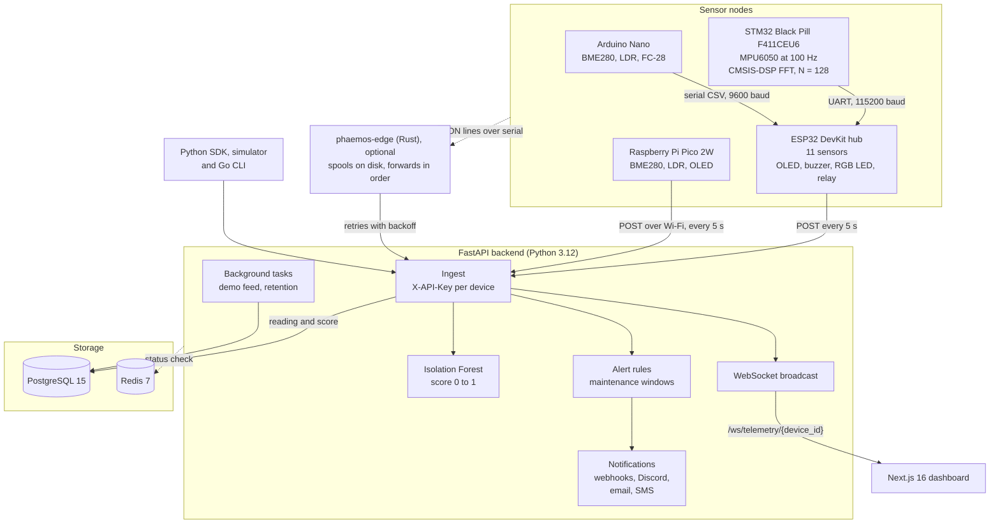
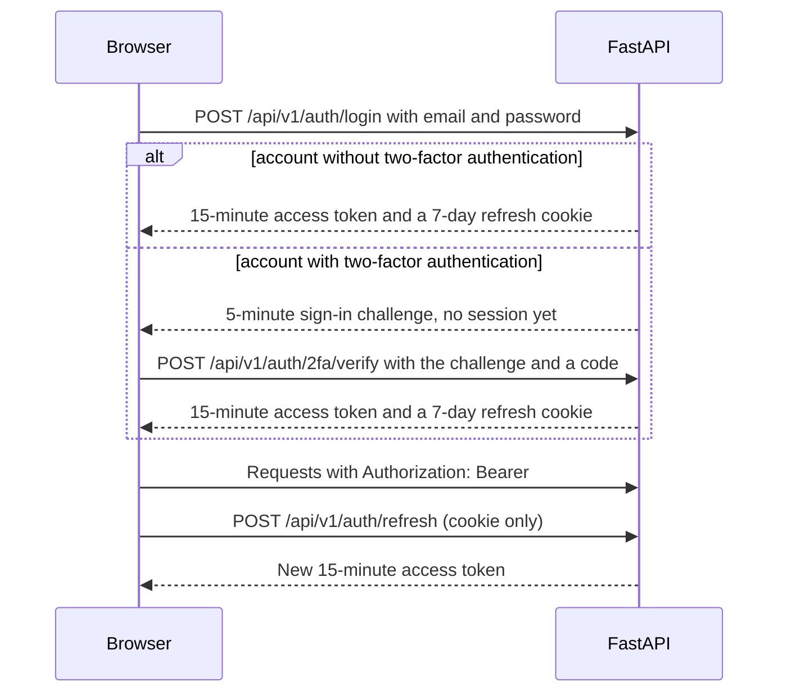
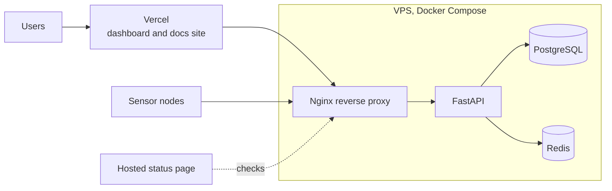

# Architecture Overview

PHAEMOS has five layers: sensor nodes on the machines, an optional edge gateway beside them, a FastAPI backend that scores and stores every reading, PostgreSQL for storage and a Next.js dashboard.

## System diagram



The dashboard reads everything else through the REST API under `/api/v1`.

## Nodes and links

| Node | Board | Sensors and outputs | Link |
| --- | --- | --- | --- |
| Hub | ESP32 DevKit V1 | BME280, MPU6050, INA219, MLX90614, VL53L0X, MQ-2, AS5600, MAX4466, DS18B20, LDR, FC-28. Outputs: OLED, buzzer, WS2812B RGB LED, relay | Merges the other two nodes' data and posts JSON to the API every 5 s |
| Vibration | STM32 Black Pill F411CEU6 | MPU6050 sampled at 100 Hz, CMSIS-DSP `arm_rfft_fast_f32` FFT with N = 128 | UART to the hub at 115200 baud |
| Auxiliary | Arduino Nano | BME280, LDR, FC-28 | Serial CSV to the hub at 9600 baud |
| Ambient | Raspberry Pi Pico 2W | BME280, LDR, OLED | Posts JSON to the API over Wi-Fi every 5 s |

The Rust edge gateway is optional. It reads JSON lines on standard input (for example a node's serial port), appends each reading to a spool file and syncs it to disk, then forwards spooled readings in order. When the API is unreachable it keeps them and retries with backoff (1, 2, 4 seconds and so on, capped at one minute), so an outage or reboot loses nothing. Details are in [edge/README.md](https://github.com/phaemos/phaemos/blob/main/edge/README.md).

## Ingesting a reading

```mermaid
sequenceDiagram
    participant N as Node or edge gateway
    participant A as FastAPI
    participant M as Isolation Forest
    participant D as PostgreSQL
    participant R as Alert rules
    participant W as Dashboard

    N->>A: POST /api/v1/telemetry with X-API-Key
    A->>A: Look up the device by its key
    A->>A: Stop any sensor the post names in faults: its fields become null
    A->>M: Score the reading, only if every feature the model needs is present
    M-->>A: Score from 0 to 1 from the machine's own model or its node type's or the general one, 0.7 or above is outside normal (or no score)
    A->>D: Save the reading with its score and anomaly flag and the node's health fields
    A->>R: Check the device's rules, skipped during a maintenance window
    R-->>A: Alerts for every rule that fires
    A->>D: A sustained spell of anomalous readings (most of two minutes) raises one alert and opens a ticket; a calmer five minutes clear it
    Note over R: Each alert goes to the webhooks and email.<br/>Warning and critical alerts also go to Discord.<br/>Critical alerts also send an SMS.<br/>All of these run after the response is sent.
    A-->>W: Broadcast the reading over WebSocket
    W->>A: Poll /telemetry/{device_id}/latest every 5 s as a fallback
```

### A failed sensor is not a machine alarm

A node says what it cannot measure in the `faults` object of its post, for example `{"bme280": "missing"}`. The sensor map in `app/services/sensor_map.py` turns a sensor key into the telemetry fields it produces. For a faulted sensor those fields are stored as null, with the value the node sent kept in the row's `quality` and so no threshold rule fires on them. The anomaly model scores a row only when every feature it needs is present. The general model, which scores node types without a model of their own, is trained on the columns that at least 90 per cent of all readings carry (the most common one when none reaches that share), so a mixed fleet still ends up with a general model. A row with a missing feature gets a null score and counts as neither normal nor anomalous, so a node that drops a sensor can no longer open an anomaly ticket. The anomaly alert reads only scored rows (see below) and training leaves out rows with a missing feature.

The rest of the post's health fields (`seq`, `boot`, `up`, `ts`, `reset_reason`, `rssi`, `heap_free` and `fw`) update the one `device_health` row for the device. A jump in `seq` adds to the count of lost posts. A rise in `boot` is a restart and three in ten minutes open a monitoring alert for a restart loop.

### A failed sensor is visible

A fault never raises a machine alarm, but it is not silent either. A sensor that stays in `faults` for 60 seconds opens one monitoring alert for that device and sensor, which resolves when the sensor has reported ok for 60 seconds. A sensor that changes state more than five times in an hour gets one alert that says it is intermittent and not one per change. The timing is kept in `device_health.sensor_track`, so a post is enough to run it and no sweep is needed. A sensor an admin marked as not fitted on the machine raises nothing and is shown as not fitted. A node that keeps posting but has had no scored reading for 10 minutes raises its own alert naming the model inputs it lacks, which also covers a field that goes missing with no fault named (a range sensor with no target, an I2C sensor in its first two missed probes, a sensor that answers on the bus but fails its set-up). A threshold rule whose field is null because its sensor is faulted is listed in the device's health read as one that cannot be evaluated and raises no alert of its own.

### The anomaly model

**What is measured and what is not.** Every figure in this section comes from simulated machines (`make ml-eval`, `backend/app/scripts/evaluate_model.py`). No real machine has been seen. The simulator's machines are healthy except for the faults injected into them, their room follows a daily cycle, a slow season and day-to-day weather, their load follows shifts. Every sensor's noise carries from one reading to the next. Real fault sizes and shapes, real seasonal and duty drift against the nightly retrain and real delivery latency and jitter can only be settled on real machines.

<!-- evaluation:start -->

**What it detects and what it does not.** These are the figures of the full evaluation (`python -m app.scripts.evaluate_model --full test`). The settings it depends on (the detector's allowance, the time constant and the bound of the slow adaptation) were chosen on three other seeds (the validation seeds) and never on these.

!!! note "Figures from simulated data"
    The false alert figures below come from simulated machines only on 6 seeds the tuning never saw, under the simulator's assumptions: a room with a daily cycle, a slow season and day-to-day weather, a load that follows shifts with stoppages, sensor noise that carries from one reading to the next, faults injected with the stated sizes and shapes and the same generator for training and testing. No real machine has been measured. Real fault sizes, seasonal drift and delivery jitter can only be settled on real machines.

Measured on test seeds 7101, 7202, 7303, 7404, 7505, 7606, which no setting was chosen on, with 8 simulated machines a seed (six without an ambient reference and two with one), each trained on 14 days and tested on the 7 days after them. A machine-seed with no working model counts in every row (none had one missing here). The 95% intervals are a bootstrap over machine-seeds: each machine's week and its trials are resampled together, because they are not independent. A detection trial starts primed (its slow levels set from its own first healthy hour, as a machine in service has them) while a healthy week starts cold.

| Healthy test week, after this change | False alerts | Machine-weeks | Per machine-week | 95% interval | With an ambient reference | Without one |
| --- | --- | --- | --- | --- | --- | --- |
| no change | 32 | 48 | 0.67 | 0.40 to 0.96 | 0.58 | 0.69 |
| hotter week +3 °C | 73 | 48 | 1.52 | 0.94 to 2.27 | 0.58 | 1.83 |
| seasonal drift 0.3 °C a day | 51 | 48 | 1.06 | 0.67 to 1.46 | 0.58 | 1.22 |
| lighter product (load x0.7) | 40 | 48 | 0.83 | 0.54 to 1.15 | 0.75 | 0.86 |
| 24 h duty | 47 | 48 | 0.98 | 0.69 to 1.27 | 1.08 | 0.94 |
| temperature noise x3 (test) | 38 | 48 | 0.79 | 0.44 to 1.21 | 0.67 | 0.83 |
| posting interval x2 | 20 | 48 | 0.42 | 0.19 to 0.71 | 0.25 | 0.47 |
| posting interval x6 | 11 | 48 | 0.23 | 0.06 to 0.44 | 0.08 | 0.28 |
| 20% of readings lost | 30 | 48 | 0.63 | 0.33 to 0.96 | 0.58 | 0.64 |
| 30 s outage every 10 min | 32 | 48 | 0.67 | 0.38 to 1.00 | 0.75 | 0.64 |
| humidity no longer tied to the room | 19 | 24 | 0.79 | 0.33 to 1.38 | 0.67 | 0.83 |
| temperature noise x3 all along | 16 | 24 | 0.67 | 0.29 to 1.13 | 1.00 | 0.56 |

!!! note "Figures from simulated data"
    The detection figures below come from simulated machines only on 6 seeds the tuning never saw, under the simulator's assumptions: a room with a daily cycle, a slow season and day-to-day weather, a load that follows shifts with stoppages, sensor noise that carries from one reading to the next, faults injected with the stated sizes and shapes and the same generator for training and testing. No real machine has been measured. Real fault sizes, seasonal drift and delivery jitter can only be settled on real machines.

| Fault injected into the healthy test week | Alert within | Caught | Share | 95% interval | Median time to alert | 90th percentile |
| --- | --- | --- | --- | --- | --- | --- |
| temperature step +1 °C, 1 h | 30 min | 31 of 168 | 18% | 9% to 29% | 12 min | 18 min |
| temperature step +2 °C, 1 h | 30 min | 97 of 168 | 58% | 43% to 71% | 9 min | 16 min |
| temperature step +3 °C, 1 h | 30 min | 118 of 168 | 70% | 57% to 83% | 6 min | 12 min |
| temperature step +5 °C, 1 h | 30 min | 150 of 168 | 89% | 82% to 96% | 4 min | 21 min |
| temperature step +8 °C, 1 h | 30 min | 166 of 168 | 99% | 96% to 100% | 3 min | 15 min |
| temperature step +3 °C at a start-up | 30 min | 115 of 120 | 96% | 92% to 99% | 6 min | 12 min |
| slow drift +0.5 °C an hour for 6 h | 360 min | 88 of 168 | 52% | 39% to 65% | 216 min | 320 min |
| slow drift +2 °C an hour for 6 h | 360 min | 167 of 168 | 99% | 98% to 100% | 70 min | 204 min |
| intermittent +5 °C, 10 min on and 10 min off, 4 h | 60 min | 124 of 168 | 74% | 62% to 85% | 4 min | 12 min |
| +4 °C only while running, 8 h | 120 min | 123 of 168 | 73% | 67% to 79% | 23 min | 93 min |
| vibration +50% ramped over 2 h | 120 min | 74 of 144 | 51% | 48% to 55% | 67 min | 85 min |
| vibration x2 step, 1 h | 30 min | 136 of 144 | 94% | 89% to 99% | 4 min | 10 min |
| current +10% step, 1 h | 30 min | 4 of 120 | 3% | 1% to 7% | 16 min | 27 min |
| current +25% step, 1 h | 30 min | 74 of 120 | 62% | 53% to 68% | 6 min | 10 min |
| simulator temperature step (the simulator's own size, a multiple of the healthy value) | 30 min | 166 of 168 | 99% | 96% to 100% | 2 min | 8 min |
| simulator slow drift (the simulator's own size, a multiple of the healthy value) | 180 min | 150 of 168 | 89% | 83% to 95% | 57 min | 109 min |
| simulator vibration rise (the simulator's own size, a multiple of the healthy value) | 60 min | 142 of 144 | 99% | 96% to 100% | 9 min | 17 min |
| simulator current spike (the simulator's own size, a multiple of the healthy value) | 10 min | 115 of 120 | 96% | 90% to 100% | 1 min | 2 min |

!!! note "Figures from simulated data"
    The figures in this paragraph come from simulated machines only on 6 seeds the tuning never saw, under the simulator's assumptions: a room with a daily cycle, a slow season and day-to-day weather, a load that follows shifts with stoppages, sensor noise that carries from one reading to the next, faults injected with the stated sizes and shapes and the same generator for training and testing. No real machine has been measured. Real fault sizes, seasonal drift and delivery jitter can only be settled on real machines.

In words. A step of 8 °C in a machine's temperature, a drift of 2 °C an hour, a vibration that doubles and the simulator's own large faults are caught within their deadlines in about nine runs of ten or more. A step of 5 °C is caught in nine of ten within 30 minutes, one of 3 °C in seven of ten, one of 2 °C in a little under six of ten and one of 1 °C in about one of five. A current change of a tenth is almost never caught and one of a quarter in about six runs of ten. A warmer room is the hardest case for a node with no ambient reference: a week 3 °C warmer raised 1.83 false alerts per machine-week on those nodes against 0.58 on nodes with an air temperature beside the machine temperature. In a warmer week detection falls too, because an alert already open for the warmer room hides a fault that starts under it. The healthy-week rate of 0.67 per machine-week is inside the budget of one. So is the top of its grouped interval (0.40 to 0.96).

!!! note "Figures from simulated data"
    The figures in this paragraph come from simulated machines only on the 6 test seeds, with the trade measured on the validation seeds 9101 and 9202 and the quarter-size figure from seeds 4242 and 5353, under the simulator's assumptions: a room with a daily cycle, a slow season and day-to-day weather, a load that follows shifts with stoppages, sensor noise that carries from one reading to the next, faults injected with the stated sizes and shapes and the same generator for training and testing. No real machine has been measured. Real fault sizes, seasonal drift and delivery jitter can only be settled on real machines.

**The weakest spot is a slow drift.** A drift of half a degree an hour is caught in about half the runs and late (a median of 3.6 hours). The review's second pass found a quarter-size simulator drift caught 32 per cent of the time within 3 hours. The slow adaptation is what lets it through: its 2 hour time constant follows a slow drift for a while. On the validation seeds a 6 hour time constant caught 30 of 30 such drifts against 24 of 30, at the cost of 6 false alerts in 10 machine-weeks against 4 on a healthy week and 14 against 7 in a warmer week. We kept 2 hours, because false alerts on a healthy machine cost more trust than a drift caught a few hours later. We state the drift as the model's weakest spot.

!!! note "Figures from simulated data"
    The figures in this paragraph come from simulated machines only on 2 of the test seeds (7101 and 7404), under the simulator's assumptions: a room with a daily cycle, a slow season and day-to-day weather, a load that follows shifts with stoppages, sensor noise that carries from one reading to the next, faults injected with the stated sizes and shapes and the same generator for training and testing. No real machine has been measured. Real fault sizes, seasonal drift and delivery jitter can only be settled on real machines.

**A site reference.** On two of the test seeds (7101 and 7404) every machine was also given a room node in the same place as its ambient source. On the ten machine-weeks of nodes with no air temperature of their own, a week 3 °C warmer fell from 32 false alerts to 11, a healthy week from 10 to 7 and a seasonal drift went from 17 to 19 (the presses and the pump fell from 15 to 7, the room sensors rose from 2 to 12). On the presses and the pump a +2 °C step was caught 24 times of 24 against 21 and a drift of half a degree an hour 24 of 24 against 16. Nodes with their own pair and the vibration node were unchanged, as they should be.

!!! note "Figures from simulated data"
    The figures in this paragraph come from simulated machines only on seed 22 of the review's simulator, which no setting was chosen on, under the simulator's assumptions: a room with a daily cycle, a slow season and day-to-day weather, a load that follows shifts with stoppages, sensor noise that carries from one reading to the next, faults injected with the stated sizes and shapes and the same generator for training and testing. No real machine has been measured. Real fault sizes, seasonal drift and delivery jitter can only be settled on real machines.

**Retrains, lost state and a forged walk.** On the review's simulator (seed 22, six machines, 6 machine-weeks), with the models swapped at every nightly retrain and the state carried across, the week raised 4 false alerts against 5 with no retrain at all and 4 with a cold start every night. A state lost every hour, which in service happens only when an admin rotates a key or accepts a counter, raised 16 (2.7 a machine-week, 13 of them on one machine), against 6.17 a machine-week for the old cold start. A stolen key walking the temperature up 0.3 °C a day with a retrain every other night: the new models were accepted until the walk had moved the machine's normal 2.2 in-state spreads from the first model accepted for it (night 28, 8.4 °C walked from the start). From then on every retrain was refused with a `model_move` alert until a person accepts. The model in service raised one alert in the 26 days that followed (on day 33.6) while the walk went on to 12 °C, because its live level followed the walk up to its bound: the move alert, not the live score, is what catches a walk this slow.

<!-- evaluation:end -->

**Three parts per machine.** A machine is scored by a model of its own when it has one. The first 24 machines (oldest first, the setting `ML_MAX_MACHINE_MODELS`) get a full model: an Isolation Forest, a per-sensor baseline and a sequential change detector. Every machine beyond the cap gets a light model of its own: the baseline and the detector without the forest. A machine with no model of its own yet is scored by its node type's model and failing that the general model, both pooled over machines. A model is used only when the reading carries every column it needs, so a reading that lacks one is left unscored, which counts as neither normal nor anomalous. A machine no model scores is shown as not monitored (`monitored` false with the reason) and the retrain raises a monitoring alert for it.

**What a score means.** scikit-learn's `score_samples` returns a number between -1 and 0 where lower is more abnormal. We set the forest's offset ourselves to a boundary we measure and map the distance from it onto 0 to 1, so a typical healthy reading is 0 and the boundary is 0.7 (`ANOMALY_THRESHOLD`). The baseline and the detector are mapped onto the same scale and a reading's score is the largest of the three. Nothing downstream changes scale.

**Fit, validation and test.** The clean readings of a machine are split by time. The oldest 60 per cent fit the model. The next 20 per cent (validation) set every boundary and every tightening: the raw score only 1 reading in 1,000 of the healthy validation readings is worse than, then a replay of those readings through the real alert decision (`services/anomaly_decision.py`, the same function the live path calls), then a stricter quantile while the false alerts are over one per machine per week. The faults injected to check detection go into the validation readings too. The newest 20 per cent (test) is touched by nothing that is tuned: the reported false alert figure and its exact 95 per cent interval come from it alone. So does the champion and challenger comparison. The test part must cover at least a day, so a machine needs five days of clean readings at a 5 s interval before it has a model of its own (`hours_needed`). Neighbouring readings are alike, so a figure from two or three days is weak evidence: with no false alert in 42 hours the 95 per cent upper bound is about 15 a week. The status says so beside the figure.

**When a new model replaces the one in service.** It is refused when it is over the budget on validation, when it catches fewer than 60 per cent of the injected faults within their deadlines or none could be injected, when its detector boundary is above half the accumulator's cap (it could hardly ever be crossed), when on the same newest readings it raises more false alerts than both the model in service and the budget or catches a tenth fewer of the same faults. It is also refused when it would move the machine's normal more than one in-state spread from the model in service or two from the first model accepted for it (the anchor). That last refusal guards against a slow walk, which is what a drifting fault or a forged sensor looks like: a person accepts a real change with `POST /ml/machines/{id}/accept-move` and the next retrain re-anchors there. A model the retrain does not replace is carried over for at most 7 days after it was trained and then withdrawn, so a model that keeps being refused cannot hold a stale alert open for ever.

**Which rows teach the model.** Training reads the last 14 days of each machine, one machine at a time in its own short transaction. It chooses rows in SQL. A row is refused when it was taken in a maintenance window (the machine's or a fleet-wide one), carries a sensor fault or a rejected or dropped value, sits next to a gap in the posts longer than four intervals. It is also refused when it was taken while a rule alert or a model alert a person confirmed as a real fault (`alerts.fault_confirmed`, set with `POST /ml/alerts/{id}/verdict`) was open. The model's own unconfirmed alert refuses nothing: when it did, a machine whose normal had changed kept its alert open, was never retrained on the new normal and never cleared. The posting interval is the one the readings show when it differs from the device record by more than half again. The fit rows are sampled evenly in time (at most 20,000) and the validation and test parts are at the full posting rate (at most 30,000 each). A node type model and the general model pool the machines: every machine gives an equal share of the fit rows and the held-back parts come from at most 12 machines spread through the fleet, each with a long enough run to inject faults into.

**The per-sensor baseline.** Each model carries a baseline (`services/baseline_check.py`) that answers the question a forest cannot: how far outside its usual range is one sensor. The fit rows are grouped into at most four operating states and each sensor keeps a median and a robust spread per state. A sensor is judged against the state chosen from the other sensors, so a faulty sensor cannot pick the state that suits it. It is read against its own healthy tail measured on validation, so one sensor with harmless bursts (a forklift on the vibration) does not set the limit for every other.

**The change detector.** For each sensor of a machine it predicts the value from the machine's other sensors (their present values and two smoothed views over 5 and 30 minutes, which carry the thermal lag) and a daily profile, by a ridge regression on the fit rows. A sensor that the others explain less than half of is not watched. The residual's spread is modelled as small while the machine holds a state and larger for a few minutes after it changes one, both read from the fit rows. The residual is standardised by it. A two-sided CUSUM accumulates the part above the allowance (2 quiet-period standard deviations) times the minutes it lasted, so the rate does not depend on how often a node posts, a batch whose readings carry one instant adds nothing and a reading seen twice adds nothing the second time. Its boundary is the 1 in 1,000 quantile of the validation accumulator moved a quarter further out (never under 15 standard-deviation minutes). The run length between false crossings is stated honestly: with none seen it is censored, `arl_hours` is null and only its 95 per cent lower bound (a third of the hours watched) is given. A gap of more than five minutes restarts the smoothed views with a 30 minute warm-up, during which the accumulators are held: a silence is no evidence that a fault has gone.

**Slow adaptation within a bound.** The level of each residual (the weather, a warmer room, a season, a lighter product) is followed by a time-weighted average over 2 hours and taken off before the CUSUM. Each sensor's level in each operating state is followed the same way and taken off before the forest and the baseline judge a reading. Each level is clipped to a bound read from how far it wandered on readings the fit never saw (4 times the hour-to-hour wander of the residual), so a change larger than the machine was seen to wander is never learned away live and accumulates like any fault. A machine that starts cold (its first reading, a rotated key, an accepted counter or a state that could not be carried) does not take its levels from training: for the 30 minute warm-up they are the running mean of its own readings. The detector holds its alerts through that warm-up. The cost is plain and it is in the table: a step is seen for a few hours and then taken as the new level. A change slow enough to look like weather is not seen until its level reaches the bound.

**Ambient.** A node that carries an air temperature (its BME280) beside a machine temperature (a contact probe or an infrared sensor) is modelled on the machine's rise above the air. Its room channels (air temperature, humidity and pressure) are context for the expected values and are never judged themselves: a warmer room is then not a fault. A node without such a pair has no ambient reference: its status says so (`ambient`) and the slow adaptation is all that stands between a warmer week and a false alert. A machine without such a pair can take another node in the same place as its site reference (`PUT /ml/machines/{id}/ambient-source`, set by an admin): its temperatures are then modelled as their rise above that node's air temperature, the latest one at most five minutes old. The reference is context. The status says which reference a machine uses: its own, the site's or none.

**The alert decision.** It raises when at least 80 per cent of the scored readings in the last window (the larger of 120 s and 24 intervals) are at or over the boundary and there are at least 12 of them and their median is at or over the boundary. A clear excursion raises on a shorter window (one minute or 6 intervals at the critical score of 0.85). The windows end at the machine's newest reading, not at the moment of the call, so readings that arrive up to the ingest path's live limit late (the larger of 30 s and 3 intervals) still fill them. A machine whose newest reading is older than that has gone quiet. A gap longer than the larger of 30 s and three intervals resets the raise window. The interval is the one the readings show (within a quarter and twenty times the device record's). An open alert resolves only after a calm of 30 minutes (or 120 intervals) in which the median is under 0.5, at most one reading in twenty is at or over the boundary and none in the newest minute is, so a fault that comes and goes keeps one alert open. An alert held open for 24 hours by scores that sit between 0.5 and 0.7 (the hysteresis band) with none at or over the boundary for the whole calm window is closed with a reason that tells the person the machine has not gone back to its usual readings. After a resolve a new warning waits 15 minutes and a critical one 5. Readings taken in a maintenance window are left out of the decision and the detector is paused through the window and starts its warm-up when it ends. Every number is a named constant with its reason in the module.

**What an alert says.** The reason always names a sensor. For the detector it is the sensor whose accumulator is highest, the average offset over the run and the minutes since the run began, worded as approximate: "temperature has run roughly 2.4 °C above what this machine normally shows for this load, on average over about the last 35 minutes". For the baseline it is the sensor outside its range. When only the forest carries the score the reason says the combination is unusual and names the sensor furthest from its usual value. <!-- explain:start -->

!!! simulated "Figures from simulated data"
    These figures come from simulated machines only, on one seed of the review's stress harness (seed 22, five machines with a temperature), under the simulator's assumptions (a room with a daily cycle, a season and weather, a load on shifts and noise that carries from reading to reading). No real machine has been measured. Real fault sizes, seasonal drift and delivery jitter can only be settled on real machines.

Over 145 alerts raised by additive temperature steps of 2 to 8 °C the stated offset was 0.22 to 1.73 times the true one with a median of 0.96. The stated minutes were 0.86 to 24 times the time since the onset with a median of 1.05 (the large ratios are runs that had already begun before the step). The review had measured 0.64 to 1.9 for the offset and 0.13 to 1.2 for the minutes. The edges are still wide, which is why the reason says "roughly" and "about". Every one of the 196 alerts named a sensor.

<!-- explain:end -->

**The nightly retrain.** A scheduled job retrains at 03:30 UTC with the same guard as an admin's retrain. One lock shared across workers lets only one retrain run at a time and a per-day lock makes the nightly one run once. Its outcome is written where `GET /ml/status` reads it. A machine it leaves with no working model gets a monitoring alert (`unmonitored`) and so does a machine whose new model needs a person to accept its move (`model_move`).

**The detector's state.** It lives on the device row (`devices.detector_state`, migration 039), read and written under the device row lock every ingest post already holds, so two workers take a machine's readings one after the other and neither splits nor resets the state. A test runs two separate processes against one machine and gets exactly the state one process would. A retrain no longer clears it: the state carries the basis it was written in (the detector's sensors, centre, scale and boundary) and is re-expressed in the new model's units at the machine's next reading when the new model reads the same sensors on scales within a factor of two, keeping an alert that was building or open. Only when nothing can be carried does it start cold. A failure while scoring one machine leaves that reading unscored with the reason and never marks the fleet's model as broken.

**The file is signed.** The model file is one signed envelope: a header, the HMAC SHA-256 of the header and the pickled bundle (keyed by a secret derived from the server's secret key for this purpose alone) and the bundle. The signature is checked on the bytes and only a file that verifies is ever unpickled: a file without this server's signature is refused whatever it holds, including a file from before signing. The operator is told to retrain. The signature travels inside the file, so the file is replaced by one rename and a reader racing a writer reads either the old file or the new one, never a mismatched pair. A file signed under the previous secret key verifies and is signed again at the next save. A file is read only from the model folder. The previous file is kept as `.prev`, signed, as a fallback. While a worker serves the fallback it checks the main file's signature every 30 seconds and reloads as soon as it verifies, so a file system without an atomic rename cannot leave it on the old model.

**Speed and memory.** <!-- perf:start -->

!!! note "Measured on one shared developer machine"
    These timings and sizes were measured once (scratch probe `cost_after.py` of the review re-run) on a developer laptop that was running other work at the same time, inside the development container. They are not from simulated data but they vary with the machine and its load.

Scoring one reading with its machine's full model (forest, baseline and detector) took 0.54 ms on the live path and its explanation another 0.36 ms. Earlier versions of this page said under a tenth of a millisecond, which was not true (the review measured 0.26 ms on a quieter machine). A full model is about 3.5 MB in memory once its trees are packed for scoring, so the default cap of 24 full models is about 85 MB in every API worker. A light model (the baseline and the detector) pickles to 3 to 6 kB, so any number of machines beyond the cap can have one. Training took 156 s for six machines with their pooled models, about 26 s a machine.

<!-- perf:end -->

### The alerting path

A post does all of its database work in one transaction under a per-device advisory lock, so two posts from one node at once cannot open the same alert twice or both insert the health row. The partial unique index from migration 020 makes the database refuse a second open system alert of a kind for a device. The session is closed when the route returns, before the response is sent and before any notification runs (`Depends(get_db, scope="function")`), so a webhook or email endpoint that hangs holds no connection. Notifications are queued with plain values only. A failed send keeps its repeat window for 60 seconds, so one dead endpoint is tried once a minute and not on every reading. The daily email and text limits are charged when the vendor accepts a message and not before, so a vendor outage cannot use up the day. When a limit is reached it is logged once and written to the audit log once for the UTC day (there is no deployment-wide alert row: every alert belongs to a machine). A device may post 60 times a minute and gets 429 with Retry-After beyond that. The tracked sensor keys per device are bounded (every known key and four unknown ones). A model file that cannot be loaded or used never costs a reading: it is stored unscored with the reason in `quality` and the model file is written through a temporary file and a rename with the previous file kept as a fallback.

### Rule alerts and the anomaly alert

A threshold rule keeps one alert for as long as its condition lasts. What is being waited for is kept in the `rule_states` table (one row for each rule, with when the condition began to hold, when the value came back inside the limit and when a reading last carried the metric), so a hold survives an API restart and the table never grows with the readings. The open alert is updated in place and resolves by itself after a margin and a hold. A reading without the metric is no evidence either way: it breaks a pending hold and leaves an open alert as it is and the liveness sweep closes a rule alert that has had no reading meeting the condition for an hour with one statement a pass. People are told on the raise, on a rise to critical and as an hourly reminder, tracked by the alert's own `notified_at`. A send that fails clears it, so the next reading tries again and the 60 second window keeps that to one try a minute. A database index (migration 029) allows one open alert per machine and rule and another for each kind of system alert, so a race between two posts cannot leave a duplicate.

The model's alert is decided by `anomaly_decision.decide` from the machine's scored readings over the window the decision needs. `evaluate_anomaly` gathers them, acts on the answer (raise, escalate, resolve or none) and keeps the device lock, the unique index, the maintenance window, the ticket and hand resolve around it.

### Notifications run on their own threads

A vendor call can wait for its whole timeout, so none runs on a request thread. Each is handed to a small pool (`notify_pool.py`: 8 workers and a queue of 200, enough for a burst of forty machines alerting at once and not so large that a long outage grows it without bound). The request only queues a job that hands the call over, so ingest and the status check never wait on a notification. When the queue is full the oldest job that is not critical is dropped, counted and logged and a critical job is never dropped and is taken before the others, so a critical text does not queue behind a hung webhook. The repeat window is taken for a minute when a send is queued and extended to the hour only when the vendor accepts the message, so a failed send is tried again after a minute. The daily email and text limits are reserved before a send in one atomic step and given back when the send fails or is dropped, so sends in flight at the same moment cannot pass them.

A failure after the reading is committed (an alert rule that raises, the model alert) is logged once for its kind and never turns the reply into an error or drops the notifications already queued. A post takes the device row first (as the liveness sweep does) and then the device's advisory lock, with a lock timeout and is run again once after a deadlock or a lock timeout, so a reading is never lost to a lock. The model's own alert has a kind and is under the same unique index as the others.

### A silent node

Every post is a heartbeat and sets the device's `link_state` to `online`. A sweep runs every 15 seconds on the scheduler that runs the retention task. It reads the age of each device's last post against the device's `expected_interval_s`: older than 4 intervals is `late` and older than 12 is `offline`. It sets `status` to `offline` with the link and back to `online` when the link recovers, so older clients that read only `status` stay correct. When a node has been silent for 2 minutes the sweep opens one monitoring alert for it, which the next post resolves with the outage length in its message. A monitoring alert is stateful (one open alert per device and kind) and emails as a warning. It never sends the critical text message.

Several safeguards keep the sweep quiet when it should be. A Redis lock (with the in-memory fallback of the cooldown module) lets one API worker run each round. The sweep reads only the devices that can need a change (not online, late by age or with an open alert), takes a `FOR NO KEY UPDATE` lock on those rows so a post is never blocked, skips any row a post is writing and runs a fixed number of queries whatever the fleet size. The state always comes from the real age of the last post. While the API is younger than a device's offline threshold, the start-up grace only holds back bad news: a device is not moved towards late or offline and no alert opens, so an outage of the API or a deploy does not make every live node look silent. The grace never moves a device towards online, never closes an alert and never restarts the age used for the 24 hour limit, so a node that was already dead stays dead across a restart. A device silent for more than a day is shown as offline but raises no new alert. No alert is raised while the machine is in a maintenance window. Notifications go out after the sweep commits, so no row lock is held across an email.

## Models

The model is loaded from `model.pkl` on first use. An admin can retrain it with `POST /api/v1/ml/retrain`, which has a one-hour cooldown. The result is at `GET /api/v1/ml/status`. A sequence model for time-series prediction is planned for a later phase.

## Authentication



- **Token types:** access, refresh and sign-in challenge tokens each carry their purpose and are only accepted for it. The WebSocket accepts access tokens only.
- **Sessions:** every token carries the account's session version. Changing the password or turning two-factor authentication on or off raises it, which ends every other session while the current browser receives a fresh one.
- **Two-factor:** TOTP from an authenticator app, required at every sign-in once enrolled, including OAuth. Each code is accepted once. Enrolment cannot restart while two-factor authentication is on.
- **Lockout:** five failed attempts, wrong passwords and wrong codes alike, lock an account for 15 minutes. The lockout path runs even for unknown emails, so responses do not reveal which emails are registered.
- **OAuth:** Google and GitHub through `/api/v1/auth/{provider}` and `/api/v1/auth/{provider}/callback`. A random `state` ties each callback to the browser that started it. Only an email the provider reports as verified can sign in or link to an existing account. No token ever appears in a URL: the dashboard exchanges the refresh cookie for an access token. Apple sign-in is reserved and returns 501 until it is set up.
- **Invites:** an admin invites a user by email (sent through Resend) with one of the three roles. The invite link creates the account.
- **Devices:** every node sends a per-device `X-API-Key`. A key is stored only as a keyed hash (`devices.key_hash`) and found by its first 8 characters, so it can never be read back: it is shown once, in the reply that makes or rotates it. A key is replaced with `POST /api/v1/devices/{device_id}/rotate-key` by an admin or the machine's owner. A node that sends `boot` and `seq` is protected against replay: a post is accepted only when its pair is newer than the last accepted (the exact last pair is answered `200` as a duplicate and stored once, an older pair is `409`) and an admin can accept a new counter for a wiped hub.

## API surface

Every route below sits under `/api/v1`. The interactive reference is at `/docs` on a running API and the full list is in [api-reference.md](api-reference.md).

| Group | Routes | Purpose |
| --- | --- | --- |
| Telemetry | `/telemetry`, `/telemetry/{device_id}`, `/telemetry/{device_id}/latest`, `/telemetry/export` | Ingest, history, latest reading and CSV export |
| Devices | `/devices`, `/devices/{device_id}`, `/rotate-key`, `/tags`, `/devices/batch/firmware-update` | Registry, API keys, tags and batch firmware updates |
| Alerts | `/alerts`, `/alerts/{alert_id}/resolve`, `/alert-rules` | Alert history and threshold rules per device and metric |
| Tickets | `/tickets`, `/tickets/{ticket_id}` | Maintenance tickets with `PHM-0001` style numbers |
| Maintenance | `/maintenance-windows` | Planned downtime that pauses alerting |
| Machine learning | `/ml/score`, `/ml/retrain`, `/ml/status`, `/ml/anomalies/{device_id}` | Scoring, retraining, the model in service and anomaly history |
| Firmware | `/firmware/upload`, `/firmware/latest`, `/firmware/download` | Over-the-air updates for the ESP32 hub |
| Auth | `/auth/...` | Sign-in, tokens, profile, two-factor, OAuth, invites, data export and account deletion |
| Admin | `/auth/users`, `/audit-logs`, `/audit-logs/export`, `/webhooks`, `/demo/start`, `/demo/stop` | Users, the audit log, webhook destinations and the demo feed |
| Fleet | `/health/summary` | Fleet health summary for the dashboard |
| Public | `/contact` | Contact form with Cloudflare Turnstile |

Outside `/api/v1`, `GET /` answers liveness checks and `GET /status` reports `operational` or `degraded` from database and Redis checks. The WebSocket lives at `/ws/telemetry/{device_id}`.

## Storage

- **PostgreSQL 15** holds devices, telemetry, alerts, rules, tickets, users, webhooks, maintenance windows and the audit log. The schema is built from the numbered SQL files in `backend/migrations/`.
- **Redis 7** runs in the Compose stack and is part of the `/status` check. WebSocket fan-out and rate limits currently live inside the API process, so a deployment with several API workers would move both onto Redis.

## Dashboard

| Area | Pages |
| --- | --- |
| Operations | `/` live dashboard, `/devices`, `/devices/[id]`, `/alerts`, `/tickets`, `/compare` (up to three devices side by side) |
| Admin | `/admin`: users, alert rules, OTA firmware, audit log, webhooks and maintenance windows |
| Account | `/login`, `/profile` (details, two-factor, data export and deletion) |
| Public | `/about`, `/blog`, `/blog/[slug]`, `/changelog`, `/docs`, `/status`, `/security`, `/faq`, `/support`, `/contact`, `/privacy`, `/terms` |

## Background tasks

Two APScheduler `BackgroundScheduler` instances run in daemon threads inside the API process. The retention scheduler also runs the liveness sweep.

| Task | Schedule | What it does |
| --- | --- | --- |
| Demo telemetry | Every 5 s while running | Generates sinusoidal readings for the demo node after `POST /demo/start` |
| Data retention | Daily at 02:00 UTC | Deletes telemetry older than 90 days, closed tickets older than 24 months, resolved alerts older than 12 months and audit log entries older than 12 months. Each rule records its row count in the audit log |
| Liveness sweep | Every 15 s | Sets each device's link state from the age of its last post, opens and resolves the monitoring alerts for a silent node and a restart loop |

These tasks open their own SQLAlchemy sessions rather than the request-scoped `Depends(get_db)`, so no session is shared across threads.

### Retention

Readings are kept for 90 days. The other periods are settings: `RETENTION_CLOSED_TICKETS_DAYS` (default 730, counted from the ticket's last update), `RETENTION_RESOLVED_ALERTS_DAYS` (default 365, from the time it was resolved) and `RETENTION_AUDIT_DAYS` (default 365). A value of 0 keeps that data for ever. Open tickets and unresolved alerts are never deleted. Closed tickets go first and a resolved alert that a remaining ticket still points at is kept until the ticket goes, so no ticket loses its alert and no delete fails on the `tickets.alert_id` key. The audit log has no keys to other tables. Sign-in sessions are deleted a day after they expire (a revoked row stays until then). Each rule deletes in batches of 10,000 rows with a commit per batch, so a large table is never locked for long and runs on its own, so one failure does not stop the others. Unresolved alerts are never deleted by age: a breaching rule writes one on every reading and nothing resolves them, but an operator may still need each of them, so a rule for them would need a way to resolve them first.

## Notifications

Every alert a rule raises goes to each enabled webhook (Slack incoming webhooks, Discord webhook URLs or Microsoft Teams connector cards). Warning and critical alerts also go by email through Resend to the configured alert addresses and post to the project's Discord channel. Info alerts are not emailed. A webhook can carry an optional template rendered with the alert's device, metric, value, threshold and severity. Critical alerts also send an SMS through Brevo to the device owner's phone number. Each channel is a no-op until its credentials are configured. Email, SMS, Discord and the webhooks all go out after the telemetry response is sent, so a slow vendor never delays a device (a node waits only a couple of seconds for its reply). The model's anomaly alerts notify the same way as a rule. A rule that stays breached notifies at once and then repeats at most once an hour per device, metric and severity on every channel, with a daily cap on email and SMS across all devices. A monitoring alert (a silent node or a restart loop) goes by email as a warning and never by SMS. Redis shares the window and the counts between workers. After one failed Redis call the windows use process memory for 30 seconds without trying Redis again, so a Redis host that accepts no packets cannot hold a telemetry request on every check.

## Deployment

**Current state:** no backend is deployed automatically. It is deployed by hand to the VPS layout below with the steps in [Deployment](deployment.md).

The target layout for the Launch milestone:



| Service | Platform | Notes |
| --- | --- | --- |
| Dashboard | Vercel | Deploys from `main` |
| Docs site | Vercel | MkDocs Material build |
| API, PostgreSQL and Redis | VPS | Docker Compose behind an Nginx reverse proxy |
| Observability | Prometheus and Grafana | Compose overlay, run on a development machine or a larger host. It does not fit the 1 GB droplet and `/metrics` is not served by the public Nginx site |
| Status page | Hosted service | Runs off the VPS so it survives a VPS outage |

Setup steps are in [deployment.md](deployment.md).

## Security boundaries

- **Devices:** `X-API-Key` on every telemetry ingest.
- **Users:** a 15-minute JWT bearer token on every protected route, refreshed from a 7-day httpOnly cookie scoped to the refresh path.
- **Roles:** `admin`, `technician` or `viewer` (the default) checked on every protected endpoint, with per-user permission overrides stored as JSONB. Admins manage every device, technicians manage their own or unassigned devices and viewers are read-only.
- **Passwords:** bcrypt through passlib.
- **Rate limits:** per IP with slowapi, for example sign-in at 5 a minute, registration at 10 an hour and the contact form at 3 an hour. The client IP comes from Nginx's `X-Real-IP` header, which is only trusted when the request arrives from an address in `TRUSTED_PROXIES`.
- **Queries:** the ORM handles almost every query. The few raw SQL statements (the audit log and the retention task) use bound parameters, so input never becomes SQL.

## Licence

Software is released under the [GNU Affero General Public License v3](https://github.com/phaemos/phaemos/blob/main/LICENSE) or later and the hardware designs under the [CERN Open Hardware Licence v2, Strongly Reciprocal](https://github.com/phaemos/phaemos/blob/main/hardware/LICENSE). [NOTICE.md](https://github.com/phaemos/phaemos/blob/main/NOTICE.md) explains which licence covers what.
