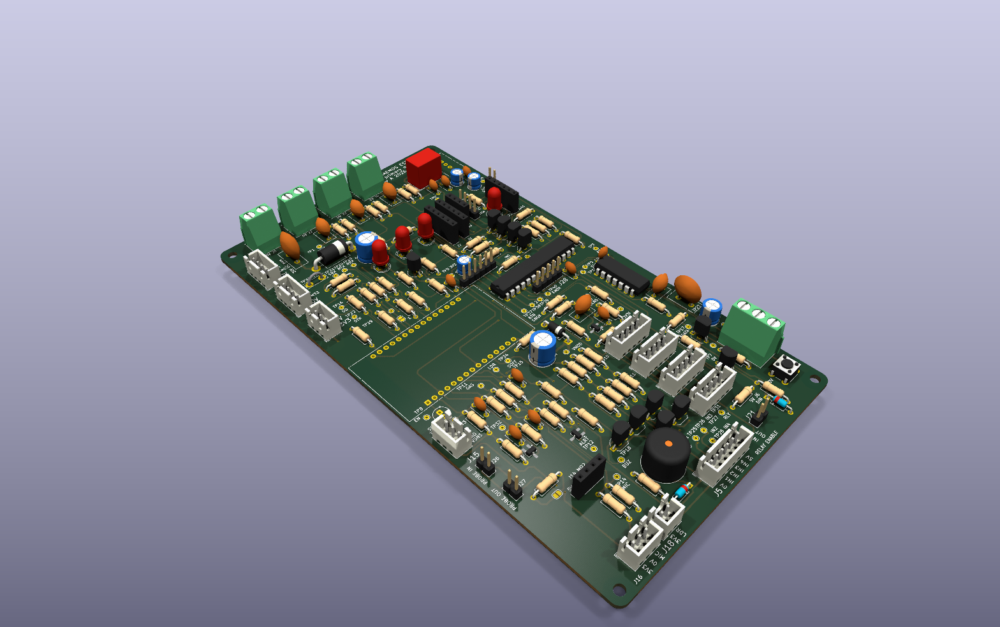
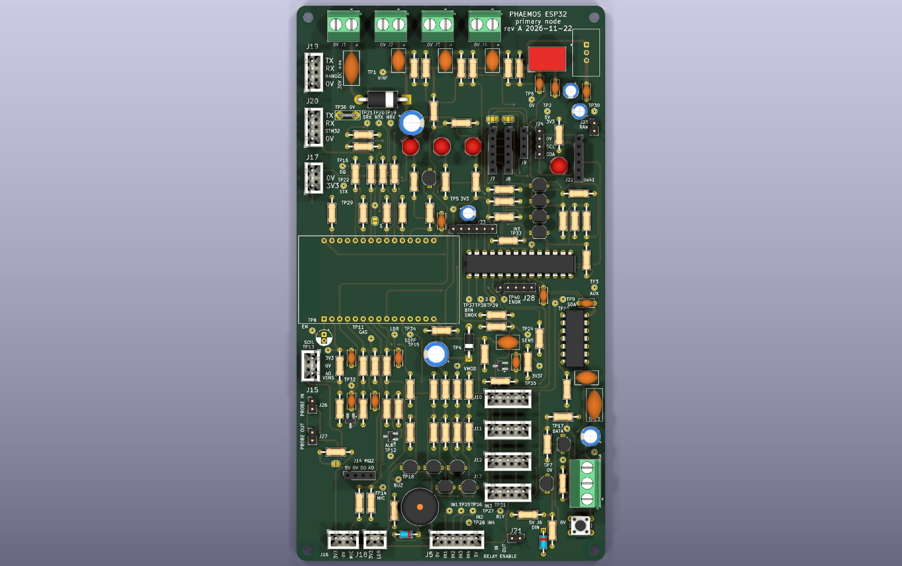
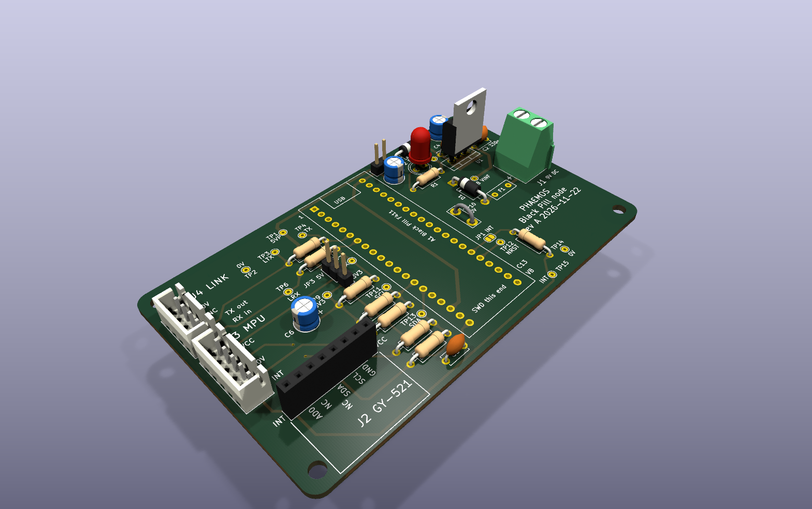
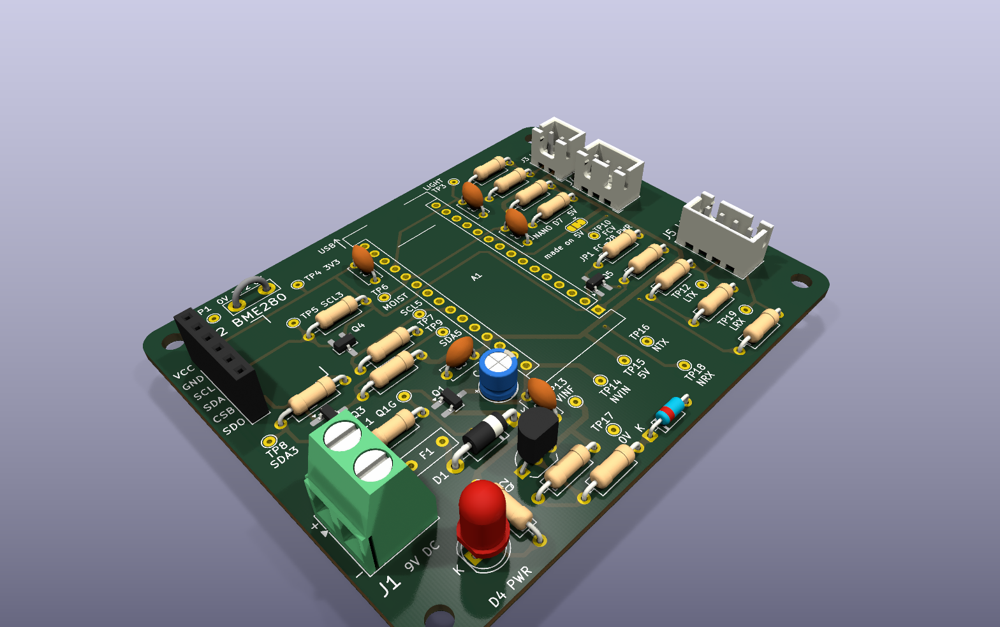
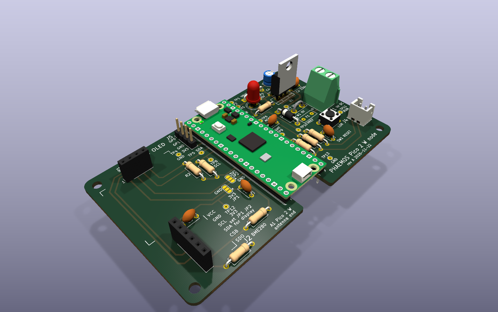

# Hardware

The hardware behind PHAEMOS: wiring, schematics, PCB layouts and the parts inventory for the four sensor nodes.

> [!IMPORTANT]
> All four node boards are fully designed and waiting to be manufactured. None has been built or tested yet. The pictures here are renders of the finished designs. We publish the KiCad files, the Gerbers and the full bill of materials once the boards have been made and tested.

> [!NOTE]
> This folder is published to [phaemos/hardware](https://github.com/phaemos/hardware) as a read-only copy. Open issues and pull requests on [phaemos/phaemos](https://github.com/phaemos/phaemos).

| Folder | What it contains |
| --- | --- |
| [`wiring/`](wiring/) | Pin assignments and wiring guides for each node |
| [`schematics/`](schematics/) | Proteus simulation projects for each node, with the KiCad schematics alongside once they are drawn |
| [`pcb/`](pcb/) | PCB layout notes and Gerber export guidance per node |
| [`inventory/`](inventory/) | The parts in stock and the parts still to source, in one list |
| [`images/`](images/) | Renders of the four boards and the three printed cases |

## The four nodes

| Node | Board | Role | Firmware |
| --- | --- | --- | --- |
| Primary gateway | ESP32 DevKit V1 | Reads 11 local sensors, collects the STM32 and Nano readings over UART and posts everything to the API over Wi-Fi | [`firmware/esp32/`](https://github.com/phaemos/phaemos/tree/main/firmware/esp32) |
| Vibration and FFT | STM32F411 Black Pill | Samples an MPU6050 at 100 Hz, runs an FFT and sends the peak frequency to the ESP32 over UART | [`firmware/stm32_blackpill/`](https://github.com/phaemos/phaemos/tree/main/firmware/stm32_blackpill) |
| Auxiliary sensor | Arduino Nano | Reads a BME280, an LDR and an FC-28 and sends them to the ESP32 over serial | [`firmware/arduino_nano/`](https://github.com/phaemos/phaemos/tree/main/firmware/arduino_nano) |
| Ambient environment | Raspberry Pi Pico 2W | Reads a BME280 and an LDR, shows them on an OLED and posts straight to the API over Wi-Fi | [`firmware/pico_w/`](https://github.com/phaemos/phaemos/tree/main/firmware/pico_w) |

Every sensor with its interface, address and expected range is in the [sensor reference](https://github.com/phaemos/phaemos/blob/main/docs/sensor_reference.md).

> [!WARNING]
> The Arduino Nano uses 5 V logic and the ESP32 uses 3.3 V. The Nano's TX line must reach the ESP32 through a level shifter or a resistor divider, as shown in the [Nano firmware guide](https://github.com/phaemos/phaemos/tree/main/firmware/arduino_nano). Wiring it straight across can damage the ESP32's RX pin.

## Where the design stands

- **Designed:** each node has its own carrier board, drawn and laid out in KiCad 10. Every schematic passes the electrical rules check and every board passes the design rules check.
- **Simulated:** the power input, reverse protection, level shifters, drivers and sensor supplies of all four boards were simulated in LTspice before ordering. The simulations found one real fault on the ESP32 board that the rule checks had passed. It was fixed and checked again.
- **Cases:** printed cases for the Nano, Pico and Black Pill nodes are designed and not yet printed.
- **Next:** the boards are made, then each node is brought up on the bench and its sensors are checked on a running machine.

The tasks are in the [Hardware milestone](https://github.com/phaemos/phaemos/milestone/4).

## Pictures

| | |
| --- | --- |
|  |  |
| ESP32 primary node | Black Pill vibration node |
|  |  |
| Nano auxiliary node | Pico 2 W ambient node |

More views of each board and case are on the node pages in [`pcb/`](pcb/).

## Licence

The hardware designs are licensed under the CERN Open Hardware Licence v2, Strongly Reciprocal (CERN-OHL-S-2.0), see [LICENSE](LICENSE). Anyone can build, modify, manufacture and sell boards made from these designs. Anyone who distributes a product based on a modified design must share the modified design files under the same licence.
