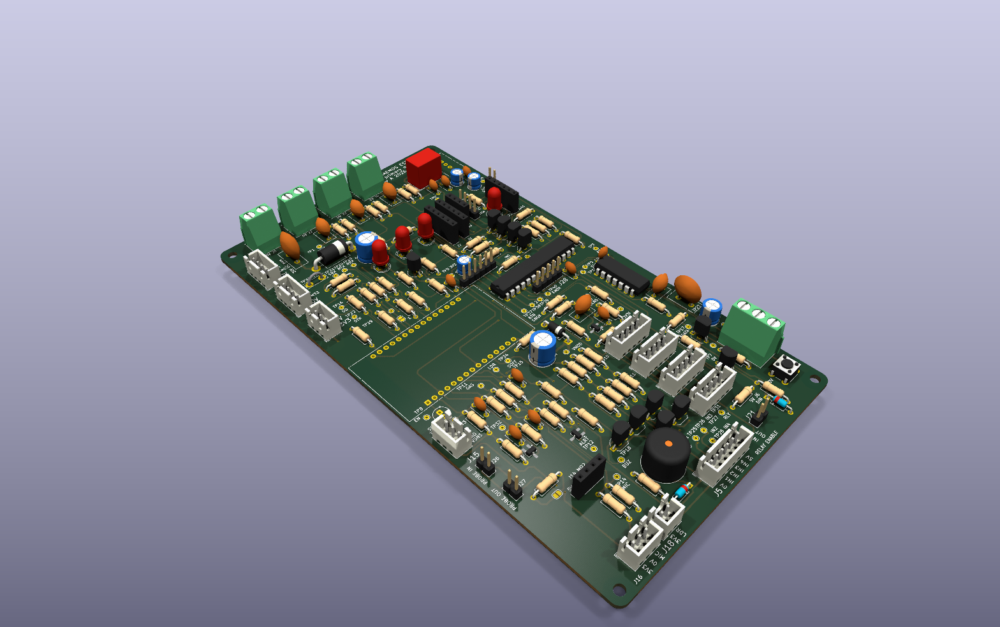
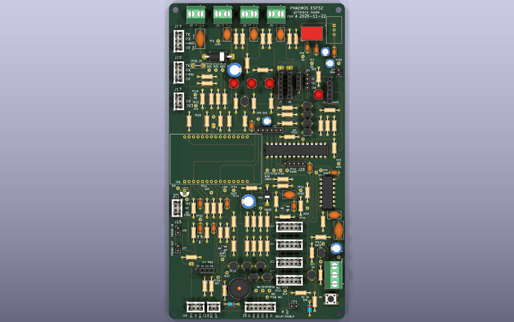
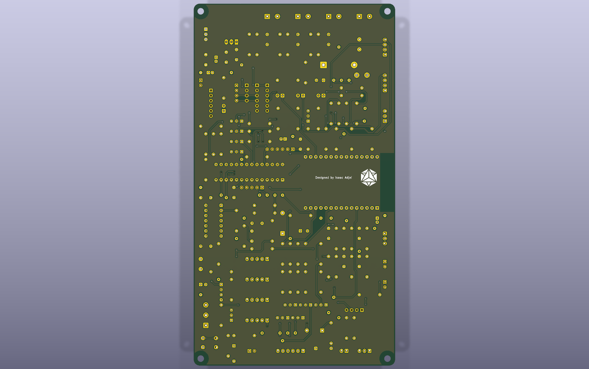

# ESP32 primary node board

The carrier board for the primary gateway, an ESP32 DevKit V1.

> [!IMPORTANT]
> Rev A is fully designed and waiting to be manufactured. It has not been built or tested. We publish its KiCad files and Gerbers once boards have been made and tested.

## Rev A

- 100 mm by 180 mm on four layers, 1.6 mm board
- Schematic passes the electrical rules check and the board passes the design rules check
- Every pin compared with the firmware and the [wiring guide](../wiring/esp32_pinout.md)
- Power input and protection simulated in LTspice

The simulation found a real fault: a reversed supply could pull GPIO39 below its rating through the input diode's leakage. A small clamp diode was added. It now stays within the rating from 0 °C up. At -40 °C with a reversed supply it can reach 1 mV past the rating, which we record as a stated limit.

## Pictures

| | |
| --- | --- |
|  |  |
| Top | Underside |
