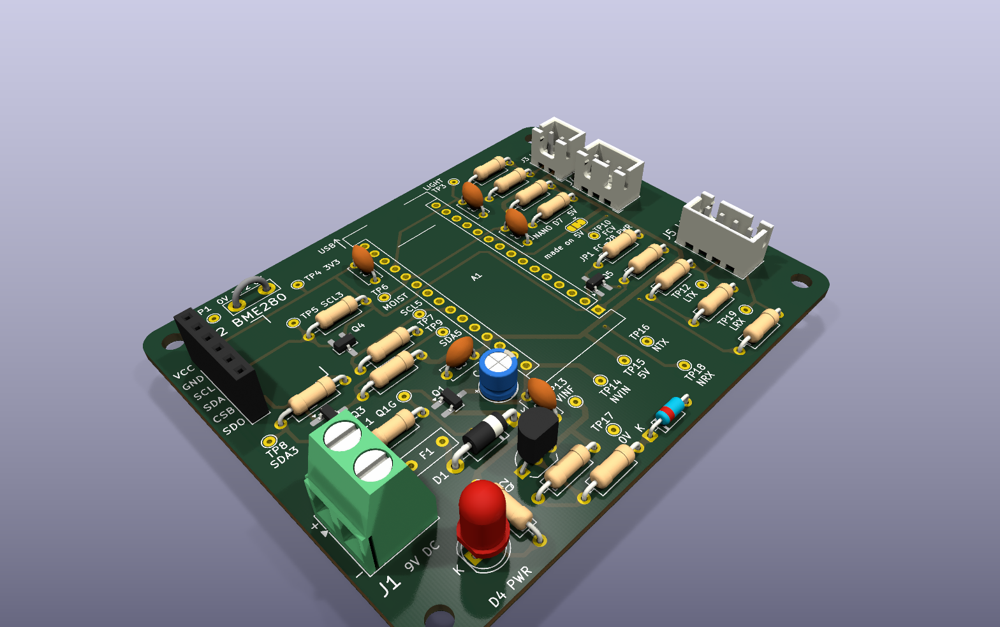
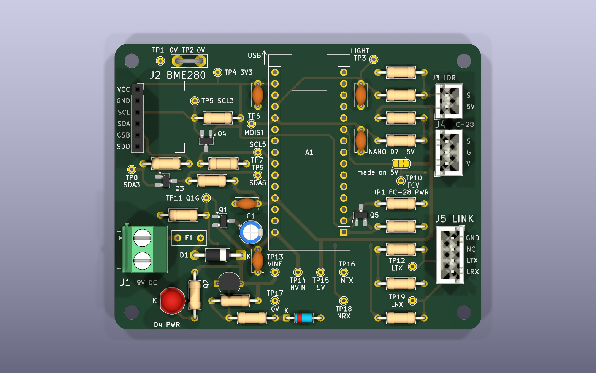
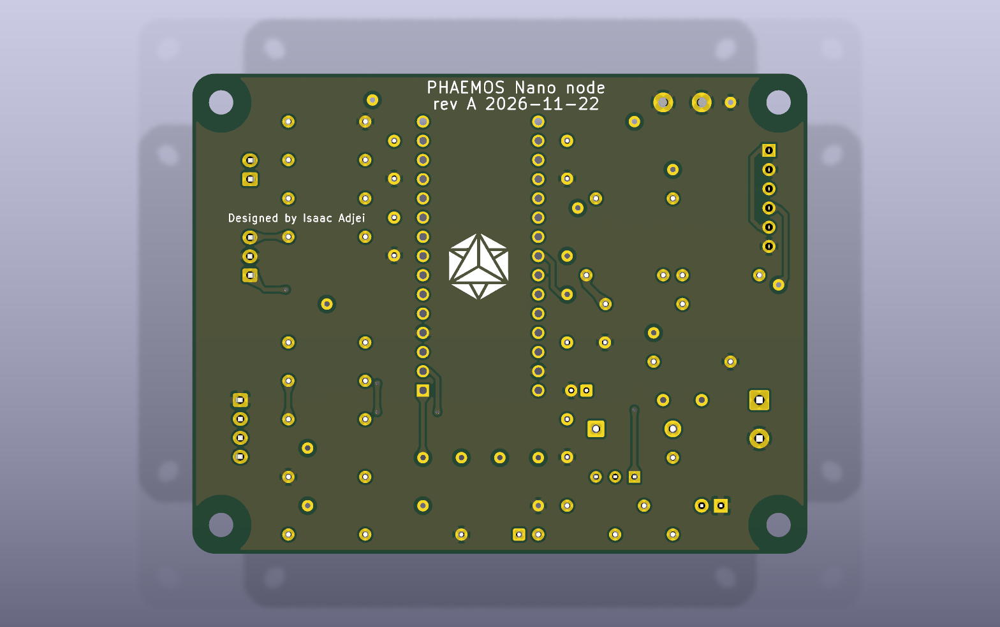
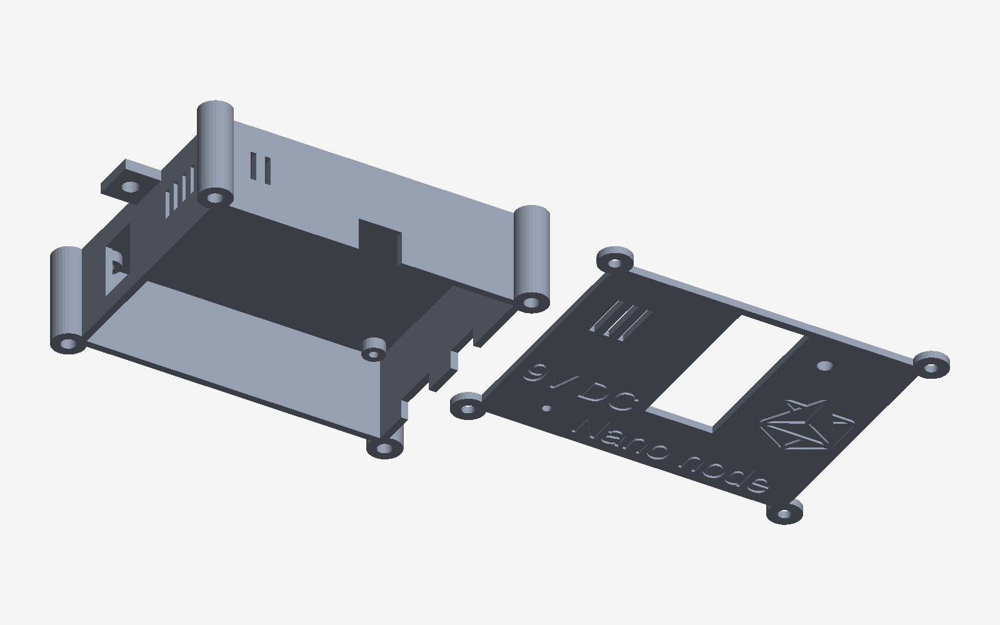
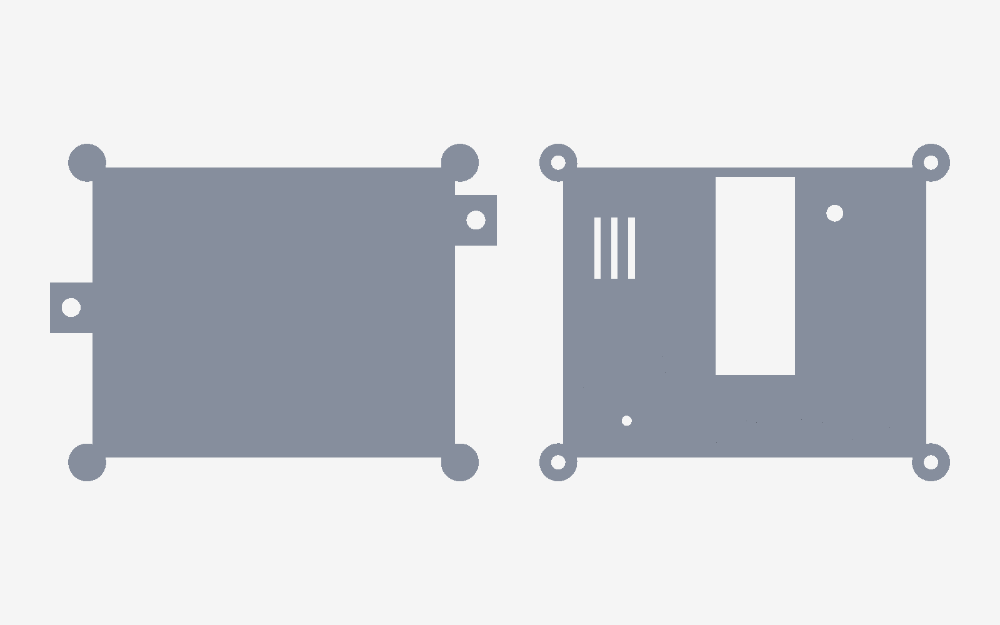

# Arduino Nano node carrier board

The carrier board for the auxiliary sensor node, an Arduino Nano.

> [!IMPORTANT]
> Rev A is fully designed and waiting to be manufactured. It has not been built or tested. We publish its KiCad files and Gerbers once boards have been made and tested.

## Rev A

- 81.28 mm by 63.5 mm on two layers, 1.6 mm board
- Schematic passes the electrical rules check and the board passes the design rules check
- Every pin compared with the firmware and the [wiring guide](../wiring/nano_pinout.md)
- Power input and protection simulated in LTspice

## Pictures

| | |
| --- | --- |
|  |  |
| Top | Underside |
|  |  |
| Case, designed and not yet printed | Case, top |
